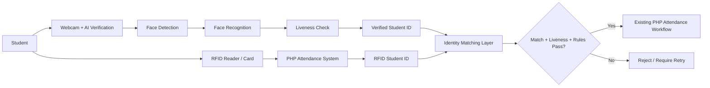

# SmartAttend Future Integration Architecture

## 1. Scope

This document describes a safe, future-ready architecture for integrating the separate Python/OpenCV SmartAttend-AI module with the existing PHP/MySQL SmartAttend system.

This phase is planning only. No website file, PHP code, MySQL schema, Arduino logic, or RFID workflow will be modified.

## 2. Current system status

### System A: SmartAttend-AI
- Python application
- OpenCV for webcam access, Haar Cascade face detection, and LBPH face recognition
- Local student registry in `dataset/students.json`
- Local face image storage in `registered_faces/<student_id>/`
- Conservative liveness logic with states such as `CHECKING_LIVENESS`, `LIVE_PERSON`, `SUSPECTED_SPOOF`, and `UNABLE_TO_VERIFY`
- Separate modules for detection, registration, recognition, liveness, evaluation, and student management

### System B: Existing SmartAttend PHP website
- PHP web application in the existing htdocs project
- MySQL database for student and attendance records
- Existing attendance logic is already in place
- Observed schema patterns indicate a `students` table with fields such as `roll_no`, `name`, and `class`
- Observed attendance logs use `roll_no`, `name`, `class`, `scan_time`, `status`, `practical_name`, and `attendance_date`

## 3. Observed identifier model

The AI module stores students as:
- `student_id`: for example `student_001`, `student_002`, `student_039`
- `name`: user-friendly student name

The website stores student identity using a different convention:
- `roll_no`: likely the operational student identifier used by the attendance system
- `name`: student name
- `class`: class/section information

This means the future integration must not assume that `student_id` and `roll_no` are identical without a verified mapping layer.

## 4. Design principles for future integration

1. Keep the existing PHP website authoritative for attendance records.
2. Keep the Python AI system as a separate verification service.
3. Do not transfer biometric data directly to the PHP system.
4. Match only a verified and mapped identifier, not raw face data.
5. Require both:</n   - face verification result
   - RFID/card identity validation
6. Preserve the current duplicate attendance controls already handled by the PHP attendance flow.
7. Treat liveness as a risk-reduction aid, not a guaranteed spoof-proof guarantee.

## 5. Proposed future verification workflow

1. A student stands in front of the laptop webcam.
2. The Python AI app detects and recognizes the face.
3. Liveness checks evaluate whether the subject is likely live.
4. The system resolves the recognized student to a canonical student identifier.
5. The student presents the RFID card to the hardware reader.
6. The website or RFID workflow reads the card/student ID.
7. The Python verification result and the RFID result are compared.
8. If both identities match and the liveness/verification checks pass, the PHP attendance workflow proceeds.
9. If identity mismatch occurs, verification is rejected.
10. If liveness is insufficient, it remains rejected or marked for manual review.
11. Duplicate attendance remains handled by the existing PHP system rules.

## 6. Recommended architecture

### High-level architecture



### Architectural decision

The safest long-term design is a two-part system:

- AI module remains independent and handles visual verification
- PHP website remains the attendance authority and handles RFID-based attendance records

The Python application should produce a verification result in a structured form, but it should not directly insert into the attendance database.

## 7. Component responsibilities

### 7.1 SmartAttend-AI module
Responsibilities:
- capture webcam frames
- detect faces
- recognize known students
- evaluate liveness using conservative heuristics
- produce structured verification output
- handle errors and user instructions
- maintain local student registry and dataset

### 7.2 Future identity mapping layer
Responsibilities:
- map `student_id` or face-recognized identity into the website's canonical identifier
- map to `roll_no` before comparing with RFID
- validate that the person being recognized is the same as the RFID-presented student
- prevent mismatched identity acceptance

### 7.3 Existing PHP attendance system
Responsibilities:
- read RFID card ID
- verify the RFID card belongs to a valid student record
- maintain attendance logs and attendance rules
- enforce duplicate attendance logic
- handle the actual attendance database transaction

### 7.4 RFID hardware layer
Responsibilities:
- read the card UID or equivalent RFID identity
- send that value to the PHP system or connected controller
- not perform face recognition logic

## 8. Data flow design

### Recommended data flow (conceptual only)

1. Face recognition returns a payload like:
   ```json
   {
     "status": "RECOGNIZED_STUDENT",
     "student_id": "student_039",
     "name": "Udayan Manoj Bhandari",
     "liveness": "LIVE_PERSON",
     "confidence": "medium",
     "timestamp": "2026-11-07T12:00:00Z"
   }
   ```
2. A separate mapping layer translates `student_039` to the website's canonical identifier used by the PHP system.
3. The RFID reader returns a card ID that the PHP site maps to the same canonical student record.
4. A verification check compares:
   - AI-recognized student ID
   - RFID-derived student ID
   - liveness result
5. On success, the PHP attendance system continues the existing attendance process.

Important: the AI module should not send raw image frames, face templates, or biometric references to the website in this planned architecture.

## 9. Communication options between Python and PHP

### Option A: REST API (recommended for future use)
Why this is the most practical option:
- standard, easy to document, easy to test
- clear request/response separation
- fits a Python service plus PHP backend
- simple authentication and auditing
- works well across local or LAN deployment

Recommended design principles:
- HTTPS only
- short-lived tokens or signed requests
- strict request validation
- API keys or service credentials stored securely, not in source code
- rate limiting and request throttling
- audit logging for every verification result
- reject requests without valid origin/session information

Use only for structured verification decisions, not for transferring images or biometric templates.

### Option B: Local queue or task message system
Why it may be useful:
- useful when the PHP site and AI system are on the same machine or local network
- allows decoupling of verification and attendance handling
- helps prevent the website from blocking on webcam processing

Use with caution:
- still requires secure authentication and identity validation
- still requires the same mapping and audit rules

### Option C: Direct database sharing
Not recommended for the future architecture because:
- couples two independent systems too tightly
- increases risk of cross-system failure
- may expose sensitive biometric or verification state in the database
- complicates security and validation

## 10. Security analysis

| Risk | Description | Recommended control | Limitation |
|---|---|---|---|
| Face spoofing | Printed image or phone replay | Use liveness checks, require card confirmation, and keep a human fallback path | Heuristic liveness is not a full anti-spoofing guarantee |
| RFID sharing | Card may be given to another student | Compare AI-recognized identity with RFID identity before attendance | Card-based identity is still only as strong as the card policy |
| Student ID mismatch | AI recognized one student but RFID identifies another | Reject mismatched verification | Requires robust mapping between IDs |
| Replay or forgery | Old verification request reused | Use signed requests, time limits, one-time tokens, and nonce checks | Needs careful key management |
| Unauthorized API requests | Attackers send forged verification payloads | Require HTTPS, authentication, request validation, and server-side logging | Strong security design still depends on proper deployment |
| Duplicate attendance | Same student marks attendance repeatedly | Keep the existing PHP duplicate rules unchanged | Only protects against repeated entries in the attendance system |
| Biometric exposure | Face data or templates leak to the web app | Do not transfer raw face images or templates | Requires careful operational isolation |
| Denial of service | AI or web service is overloaded | Rate limits, timeouts, and queueing | Can reduce throughput during peak periods |

## 11. Security requirements

The future integration design should enforce the following:

- HTTPS for all Python-to-PHP communication
- authentication for every verification request
- validated identifiers only
- request expiry and replay detection
- minimal data payloads
- no transfer of raw face images
- no direct database writes from the AI service to the attendance database
- strict audit logging to trace who was verified and when
- the PHP attendance system remains the final authority for storing attendance records

## 12. Identity comparison rules

The final verification should only succeed when all of the following conditions are met:

- face recognition produced a valid student identity
- liveness result is acceptable for the workflow
- RFID identity was successfully read
- the AI identity maps cleanly to the same canonical student identity as the RFID result
- the attendance workflow rules allow one valid attendance entry

If any part fails, the system should reject the attendance attempt or request retry.

## 13. Error handling and failure modes

### Face recognition failure
- No face detected
- Multiple faces detected
- Uncertain match
- Unknown person

Result: reject or request a reset and retry.

### Liveness failure
- `SUSPECTED_SPOOF`
- `UNABLE_TO_VERIFY`

Result: reject or request a fresh verification attempt.

### RFID failure
- RFID reader offline
- card not recognized
- invalid card mapping

Result: reject the attempt and ensure the attendance system does not mark attendance.

### Network failure
- AI service cannot reach the PHP site
- API timeout or unavailable endpoint

Result: do not mark attendance; log the failure and require retry.

## 14. Integration requirements

For a real future implementation, the project would require:

- a canonical student ID mapping table
- secure API configuration between Python and PHP
- an explicit verification result contract
- secure storage of API credentials
- monitoring and logs
- a defined retry policy
- an approval process for any attendance rule changes

## 15. Future implementation phases (conceptual only)

This phase is architecture-only. The future implementation would likely proceed in the following order:

1. Define canonical student ID mapping between AI IDs and website roll numbers.
2. Design the verification payload contract.
3. Add secure API authentication and request validation.
4. Implement verification call flow without modifying attendance records.
5. Add logging and audit trails.
6. Test mismatch and rejection scenarios.
7. Then, and only then, consider production-level attendance integration.

## 16. Final recommendation

The safest architecture is not a direct merge of the two systems. Instead, the Python AI module should remain a verification layer that decides whether the person is recognized and likely live, while the PHP system remains the official attendance processor and RFID authority.

This separation preserves:
- existing website stability
- existing attendance logic
- AI innovation freedom
- the safety and auditability of student attendance data

## 17. Explicit constraints for this phase

This document does not implement any of the following:
- no PHP website code changes
- no MySQL database schema changes
- no Arduino code changes
- no RFID workflow changes
- no actual API integration
- no biometric data transfer
- no attendance record creation from the AI system

This is a design and planning document only, and no actual integration work should proceed without explicit approval.
